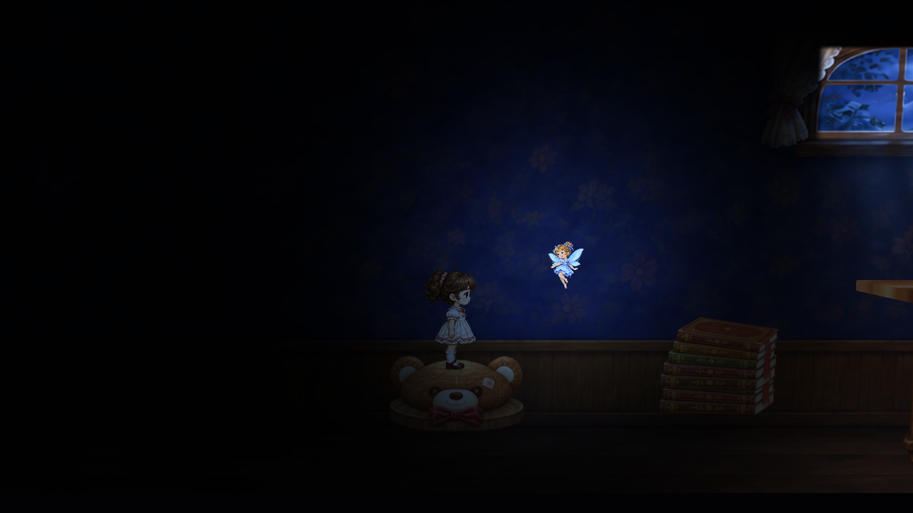
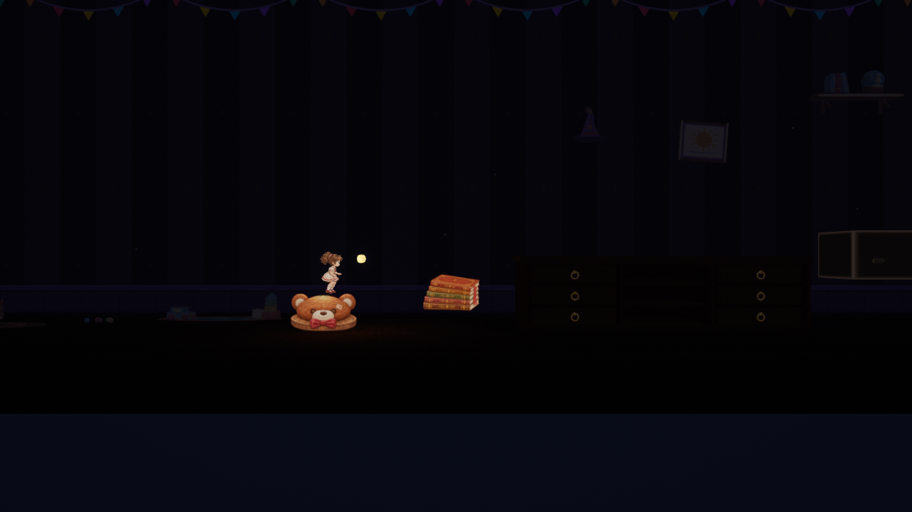

# Auditoria independente da build Windows — 13/11/2026

Sessão `2026-11-13-codex-audit-build`, Codex GPT-6. Checkout `cf5c11a`.
Pedido: validar o que foi entregue, especialmente a ausência do fundo planejado.

## Veredito

**A build existente não representa o conjunto visual aprovado. A integração está incompleta.**
O panorama e a iluminação aprovados continuam no projeto e nas evidências T05.4,
mas não foram instalados na cena jogável exportada. Não há evidência de que o
compilador tenha removido um fundo corretamente instalado. O exportador usa
TitleScreen e DarkRoom_Gameplay diretamente, sem montar a composição T05.4.

## Achados

| Prioridade | Achado | Evidência |
| --- | --- | --- |
| Alta | Fundo pintado, janela alta, penumbra e sombras de contato aprovadas ausentes da integração | Zero referências diretas da cena ao panorama v4, RoomBackgroundT054 e PenumbraLightingT054; instalação da candidata feita em RoomT054Capture, Editor, sem salvar Gameplay. Handoff e BUILD-VALIDACAO declaram a omissão. |
| Alta | Nanda ilustrada e móvel ilustrado também ausentes | Zero referências diretas a NandaFlightIllustration e FurnitureIllustrationCandidate. Captura integrada mostra ponto luminoso amarelo e móvel legado. |
| Média | Teste anterior de 30 Hz não passa | JSON: success=false e died=true. 60/120 e 60 integrado: success=true. São resultados anteriores conferidos, não testes reexecutados nesta auditoria. |
| Média | Entrada pelo menu não validada nesta sessão | Executável abriu e renderizou menu; cliques, Enter e Espaço enviados via sky não iniciaram a fase. Log inicializa input, sem exceção ou aviso de low integrity. Causa não determinada; falha de automação não prova que entrada física do usuário falha. |
| Baixa | Documentação de T06.1 tem descrição desatualizada/ambígua | README inicial diz cena não salva; instalador foi depois persistido. Relato de 30 Hz diz que passou por cima dos livros, mas JSON marca reachedBooks=true e duas decolagens/pousos; não tratar causa simplificada como diagnóstico confirmado. |

## O que foi confirmado

- Instalador da Yuna ilustrada está referenciado na cena salva; sua montagem cobre Idle/Run/Jump/Stumble e resolvedor, mantendo o controlador 3D.
- Urso e livros ilustrados aparecem na captura integrada anterior; demais omissões constam também da entrega original.
- SHA atual de Gameplay coincide com gameplayBefore/gameplayAfter do relatório capture-60-integrated.
- Exportador Windows aponta para as duas cenas corretas; log local registra Succeeded, zero erros. Compilar sem erros não valida aparência ou entrada.
- T06 e T07 permanecem pending, sem dono, no coordenador. Aprovações T03/T04/T05 cobrem entregas isoladas; não comprovam integração completa.

## Comparação visual inspecionada

Aprovado, render Unity estático da T05.4:

Integração anterior, captura real do harness T06.1 (não é captura nova do executável):

As câmeras/enquadramentos são distintos; a comparação identifica presença e
identidade dos elementos, sem alegar equivalência de escala ou diferença pixel a pixel.

## Execução e limites desta revisão

Executável existente aberto via computer-use, menu observado e entradas tentadas;
encerrado após teste. Não foi possível entrar na fase por essa automação.
Não recompilamos nem rodamos Unity Editor, PlayMode ou suíte de testes nesta sessão.
Inspeção de código, GUIDs, hashes, relatórios e imagens anteriores complementa a
observação do menu. Não houve alteração de código, cena, arte, física ou aceite.
`audit.json` registra hashes e referências consultados. Diário contém os passos.

## Correção indicada

Integrar a composição aprovada T05.4, o voo T04 e o móvel T05.3 no caminho runtime,
preservando apoios/física; conferir movimento, parallax, luz azul, materiais/shaders
na build. Investigar resultado de 30 Hz e testar menu → fase com entrada real.
Depois entregar T06.1 para revisão individual antes de T06.2/T06.3; T07 requer
piloto contínuo e aprovação humana. Esta auditoria não inicia essas alterações.
