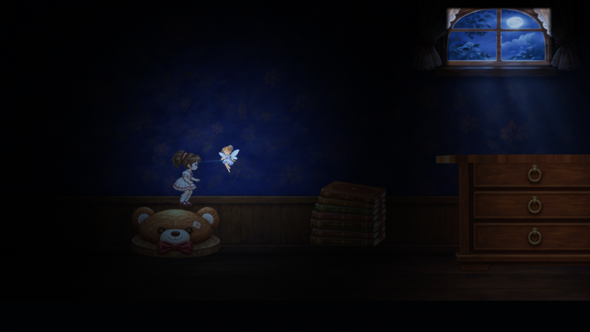
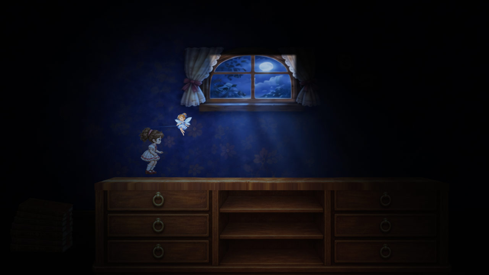

# Build de acompanhamento ilustrado — 13/11/2026

Sessão `2026-11-13-codex-follow-build`, Codex GPT-6. Pedido explícito do usuário:
“Quero um build de acompanhamento. Com tudo o que fizemos até o momento, sem cair no fallback do antigo projeto em 3D”.

**Aprovada pelo usuário em13/11/2026:** “perfeito. Aprovado.”
[Registro e escopo](reviews/acompanhamento-v6-aprovacao.md).

## Abrir

`Build/Windows/YunaLegend-Acompanhamento/YunaLegend.exe`.
**Esta é a nova entrega.** `YunaLegend-Pilot` é a build anterior incompleta.
A versão entregue foi aberta por computer-use e deixada na tela inicial para o usuário.
Clique **Começar**. Yuna corre automaticamente; Espaço, ↑ ou clique para pular.
P/Esc pausa; R recomeça. A janela também oferece reinício após falha e no fim.
A aplicação abre direto no acompanhamento; não usa o menu/caminho da build antiga.

## Conteúdo integrado

- Yuna T03: repouso com respiração/piscar, corrida, salto/pouso, tropeço e resolvedor.
- Nanda T04: oito poses de voo, acompanhamento próximo e trilha/luz azul.
- Urso T05.1, livros T05.2 com base de contato T05.4, móvel T05.3 com tampo irregular articulado.
- Panorama janela-v4, parallax 0,35, sombras de contato e penumbra-v2: luar, luz azul localizada e fosforescência tênue.
- Física 3D, CharacterController e contratos PlatformSupportProfile mantidos. O evento existente do móvel continua ativo: estralo configurado, pausa local, cedimento e tropeço.
- Cena própria `Assets/Scenes/DarkRoom_IllustratedPreview.unity`, derivada da Gameplay; produção original preservada. Trecho limitado a urso → livros → móvel, encerrado em segurança sobre o móvel. Plataformas ainda não ilustradas não são exibidas.
- Renderers antigos são ocultados e fiscalizados; transforms técnicos do móvel e colisores necessários continuam presentes. Falha de montagem oculta os visuais e mostra erro; não revela o cenário 3D antigo.

## Verificação da versão entregue (v6)

Unity 6000.3.28f1, Windows x64, NVIDIA RTX 5070. Build `Succeeded`, zero erros;
189.832.985 bytes no resumo Unity, 190.027.413 bytes na pasta entregue com LEIA-ME.

| Simulação | Percurso | Evento móvel | Reinicialização | Renderers legados visíveis | Exceções |
| --- | --- | --- | --- | --- | --- |
| 30 Hz | urso/livros/móvel | 1 evento | passou | 0 | 0 |
| 60 Hz | urso/livros/móvel | 1 evento | passou | 0 | 0 |
| 120 Hz | urso/livros/móvel | 1 evento | passou | 0 | 0 |

Todos os JSONs `v6-*/verification.json`: `success=true`, `idleCompanionNear=true`,
`stumbled/finished/reset=true`, máximo de uma fonte de Yuna visível,
cedimento máximo 0,075 m e contador local de pausa de 0,08 s.
São testes no **executável exportado**, por teclado sintético do Input System,
opt-in `-previewVerify`, com frequência de simulação fixada; não são medições de
FPS/desempenho nem equivalem a um jogador humano completando o trecho.
A consulta do tropeço agora usa Physics.Raycast 3D quando não existe collider de
fixture; isso corrige a NullReferenceException encontrada no instalador anterior.

Computer-use confirmou início e reinício por clique na candidata anterior à última
correção de companhia; interface equivalente na v6. A versão final foi reaberta
normalmente, sem flags de teste, e inspecionada após a espera na tela inicial:
Yuna, Nanda azul e quarto continuam visíveis. Mantida aberta para o usuário.

## Evidência visual

Capturas reais da câmera de gameplay no executável; excluem o overlay OnGUI.
Render HDR → display sRGB, PPM bruto convertido para PNG sem retoque ou redimensionamento.

Cada `v6-30`, `v6-60`, `v6-120` tem início imediato e estabilizado, urso, livros,
móvel, instante do estralo, fim e retry, além de JSON e log do player. O instante
`05-cracked` captura o início do evento; o cedimento máximo aparece posteriormente.
PPMs brutos permanecem em `Build/25d/preview-raw/`, fora do Git.

## Reprodução e integridade

Exportador: `YunaLegend.Illustrated25D.Preview.Editor.IllustratedPreviewBuild.Run`.
Executar Unity com `-batchmode -projectPath <projeto> -executeMethod <exportador>`
e `-logFile <log>`, sem `-quit` (o exportador encerra o Editor ao terminar).
Ele sempre monta a cena dedicada a partir da Gameplay e referencia shaders/arte
explicitamente, incluindo o shader de penumbra para impedir stripping na build.

Com o Editor do usuário aberto, foi usada cópia técnica em
`C:/Users/sergi/repos/UNITY-YunaLegend-preview-20261113`.
**872 arquivos fonte** Assets/Packages/ProjectSettings coincidem por SHA-256 entre
checkout e clone, incluindo a nova cena/metas devolvida ao checkout. A Library não
é compartilhada. Editor original preservado; clone técnico mantido para reprodução.
`manifest.json` contém o inventário de fontes e os 170 arquivos da pasta entregue.

Teste exportado: acrescente `-previewVerify <pasta-saida> -previewHz 30|60|120`
ao executável. Apenas esse modo cria teclado sintético e ignora foco para teste;
sem a flag, entrada e relógio seguem a execução normal do jogo.

## Limites

Build de acompanhamento, não aceite agregado T06/T07 nem autorização para expandir
a fase. Microentregas integradas continuam sujeitas à revisão humana. UI simples
específica do acompanhamento, sem abertura/narrativa completa; plataformas posteriores
não entram. Sem oclusão dinâmica de sombras, WebGL, aparelhos móveis ou teste de
áudio por escuta. O estralo reutiliza o clip existente; a análise não certifica mixagem.
O teste contínuo não reexecuta nem substitui o harness antigo T06.1 que parava nos livros.

Tentativas `verify-60`, `verify-60-v4` e `final-30/60/120` foram preservadas; não são
a versão entregue. As primeiras falharam no foco do teste ou revelaram a referência
nula do tropeço; a v5 passou mecanicamente, mas a observação demorada da UI encontrou
Nanda antecipando demais. A v6 usa o acompanhamento próximo aprovado e o teste
verifica também a companhia antes do início. Logs de build locais em `Build/25d/`.

## Checkpoint de publicação no Git — 13/11/2026

Após a aprovação e limpeza do menu, a saída local foi regenerada. A cena mantém
os mesmos objetos/referências; apenas quatro IDs locais e ordem dos documentos
mudaram (equivalência conferida por remapeamento). Os fontes runtime seguem
idênticos à v6;18 fontes de Editor mudaram para limpar o menu. O novo artefato
local passou novamente em60Hz, sem exceções, com travessia/cedimento/tropeço/reset.
As provas30/120Hz acima continuam vinculadas à v6 histórica, sem atribuí-las a
outro binário. `publish-checkpoint.json` guarda o inventário atual e
`publish-smoke-60/` o JSON/log. O manifesto aprovado não foi reescrito.

Próxima entrega preparada em [PROXIMO-ENTREGAVEL.md](../../../docs/ia/PROXIMO-ENTREGAVEL.md):
nova build e vídeo de falha/retry durante o evento do móvel e segunda travessia.
A estética já aprovada é o ponto de partida. Código, cenas, diário e evidências
são versionados; binários `Build/` permanecem locais e reproduzíveis pelo menu.
