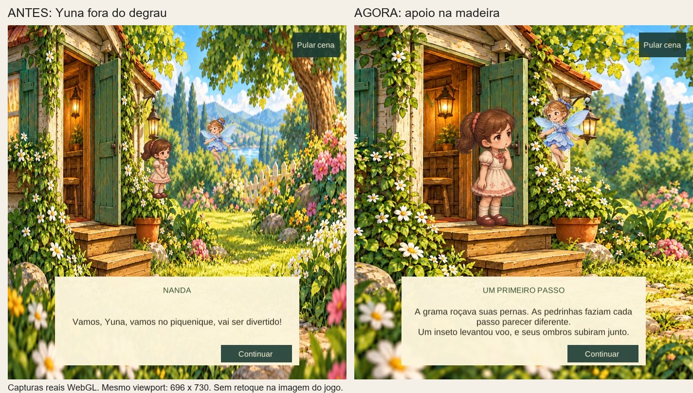
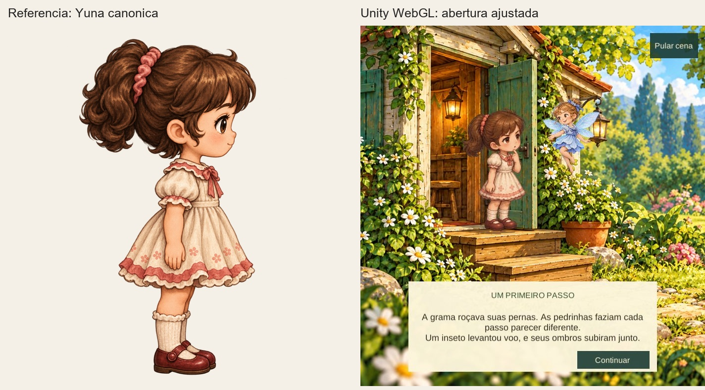
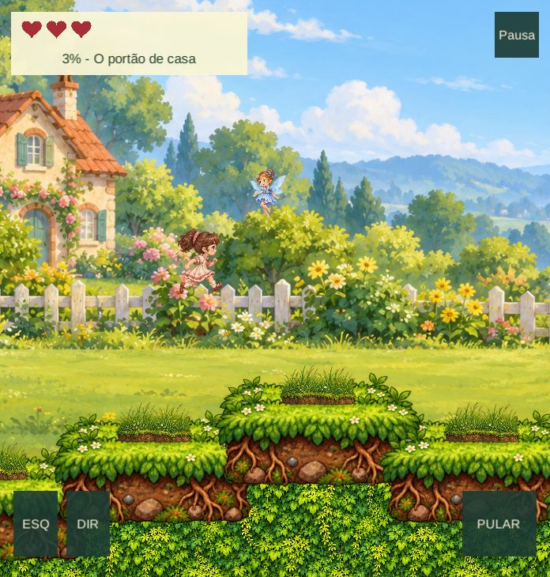

# Execução do plano — A03.1 e A04

Estado: **apoio inicial e símbolos/rótulos aprovados pelo usuário; execução interrompida a pedido para retomada posterior**, 24/11/2026. Implementação155/PIC01, sessão `codex-20261124-picnic-plan-execution`. A build de validação163 foi encerrada. Esta entrega não encerra o plano completo nem todos os requisitos de A04. [Aceite e escopo](reviews/A03.1-A04-v1.md).

A03.1 vincula a sola da Yuna ao topo do degrau superior, na coordenada (450,541) da pintura1652×952. Fundo e atores compartilham escala uniforme; a janela estreita recorta o cenário sem esticar a pintura. Yuna não recebe a oscilação vertical aplicada à fada. As poses e os arquivos de arte existentes foram preservados.

A04 substitui os glifos ausentes de vidas por malhas uGUI, mostra vidas perdidas atenuadas e infinito no modo fácil. Os controles apresentam ESQ/DIR/PULAR, mantendo as áreas de toque e os eventos existentes. O nome “A grande árvore” foi corrigido no catálogo.

## Verificação

- Unity6000.3.28f1, clone isolado `Build/PicnicVisualAuditProject`, fontes conferidos por hash. [Manifesto](validation-manifest.json).
- **25/25 EditMode**, incluindo composição, proporção, enquadramento e regressões existentes do piloto. [XML](EditMode.xml).
- **3/3 PlayMode**: malhas e estados de vidas3/2/1 e fácil; direção com pulo, soltura e pausa; correspondência sola/degrau no Canvas real. [XML](PlayMode.xml), [fixture de auditoria](PicnicPresentationRuntimeTests.cs).
- Build WebGL concluída com exit0 e `YUNA_WEB_PAGES_OK`. [Log](WebGL-build.log). As falhas intermediárias da fixture e a correção da dependência CanvasRenderer permanecem registradas no diário e nos logs.
- IAB, menu→Novo jogo→Piquenique, URL local com `?qa=1&qa_autoplay=1`. Capturas em1280×720,1920×1080,696×730,320×730 e viewport padrão696×682. Viewport restaurado após a inspeção. [Console](browser-console.json): nenhum erro capturado.
- Pausa por teclado conferida no navegador. Servidor8097 encerrado após coleta; nenhuma publicação feita.

## Limites e próximo passo

As capturas mostram as duas solas sobre a madeira e foram revisadas por um agente independente sem acesso ao código/logs. Elas não comprovam toda a animação. Em320px, os símbolos aparecem, porém textos e botões ficam pequenos; ergonomia e aparelho físico continuam pendentes de A12. A versão atual não recebeu um novo percurso completo no navegador; a calibração anterior dos saltos permanece coberta pelos testes existentes, sem alterar física ou dificuldade.

O usuário aprovou o apoio/escala inicial e os símbolos/rótulos apresentados e pediu para deixar o próximo passo para depois. Retomar por A03.2, movimento/saída da abertura, conforme o roteiro abaixo. A03 final/encerramento, os requisitos restantes de A04 e A05–A13 continuam pendentes conforme o plano; não foram declarados aprovados ou implementados nesta entrega.

## Roteiro de retomada — não executado

1. Consultar o SQLite central com `python tools/agent_registry.py status --all`, `python tools/ai_diary.py list --limit 15` e `python tools/plan_25d.py status`. Ler o último checkpoint PIC01 e a seção A03 de `Evidence/PicnicVisualAudit/PLANO-DE-ACAO.md`. O registro155 e PIC01 permanecem reservados para a sessão acima; outro agente/sessão exige handover explícito nos dois coordenadores, sem criar chave alternativa.
2. Registrar um novo `planned` para **A03.2: movimento/saída da abertura**. Mapear as poses0/1/2 aos nove beats, aproximação de Nanda, passo/descida e fade claro0,45s, ligando a composição ao personagem físico na escada sem salto de posição, escala ou orientação. Preservar as falas literais e reconciliar cabeçalho87s versus soma84s antes de alterar durações. Manter a sola aprovada e a transformação uniforme como referência.
3. Reusar `PicnicOpeningComposition`, `PicnicNarrativeController` e `PicnicNarrative` como pontos de partida; extrair os novos estados/regras para Core puro com testes. Não iniciar todo o encerramento junto. Cada nova pose/ação exige revisão individual conforme o contrato visual.
4. Verificar no Unity o ciclo completo, transição, retry e tamanhos1280×720,1920×1080 e janela estreita. Capturar vídeo sem retoque e comparação com referência. Em WebGL, usar `?qa=1&qa_autoplay=1`; a URL sem QA conserva o controle do jogador. O IAB do root funcionou; a inspeção nativa do Chrome teve bloqueio anterior de identificação da URL, sem necessidade de repetir esse caminho.
5. Para novo teste/build, reservar o recurso `Build/PicnicVisualAuditProject` em uma revisão explícita ligada ao job163 concluído. Reusar o clone cacheado, sincronizar Assets/Packages/ProjectSettings e conferir hashes antes de executar. Usar Unity6000.3.28f1 e `YunaLegend.EditorScripts.WebCiBuild.Build`; `WebPreviewBuild` não inclui Piquenique. Não executar `prepare_picnic_assets.py`, que acessa legado externo; usar os assets locais existentes.
6. Entregar A03.2 para revisão antes da etapa visual dependente. Depois, tratar anchors do encerramento/tapete, Yuna sentada/deitada e Nanda pousada/dormindo, e ações de pão/copo nos quadros6/9/11. A04 ainda requer mensagens por motivo de resgate, dica adaptada, foco/navegação por teclado e capturas individuais Normal3/2/1 e Fácil; A12 cobre ergonomia320px/aparelho físico.

Ponto de restauração: `validation-manifest.json`, XMLs e capturas nesta pasta. A calibração anterior permanece em `Evidence/Picnic/JumpCalibration` e `Evidence/PicnicVisualAudit/PooledValidation`. As alterações permanecem locais, sem commit/push; preservar o trabalho anterior em `PicnicQaPilot`, `PicnicSimulation` e medições de apoios. Não há Unity de validação ou servidor8097 deixado em execução. Não há continuação automática criada para este ponto: aguardar o usuário pedir a retomada.

[Revisão individual](reviews/A03.1-A04-v1.md). Evidências mantidas no destino já usado por PIC01, `Evidence/Picnic/`, com histórico operacional exclusivamente no SQLite central.
